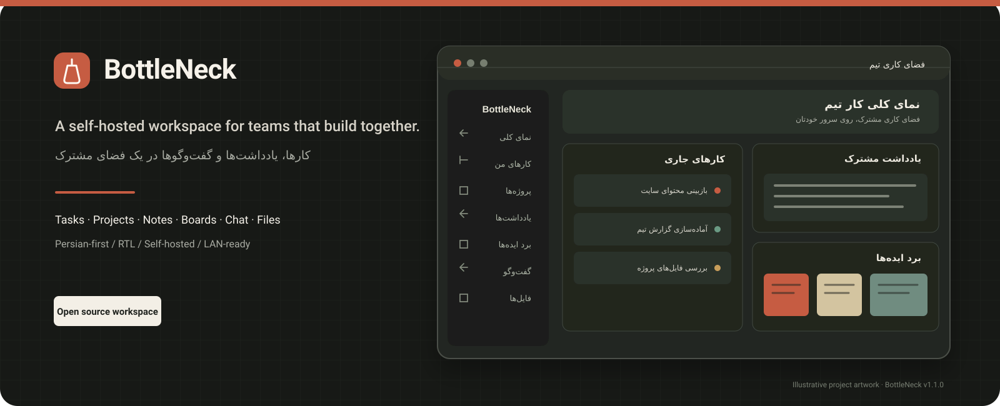

<div align="center">
  
</div>

# BottleNeck | فضای کاری مشترک تیم

**نسخه پایدار ۱.۰.۰** برای تیم‌هایی که می‌خواهند کارها، پروژه‌ها، گفتگوها، یادداشت‌ها و فایل‌هایشان روی سرور خودشان بماند.

BottleNeck یک برنامه فارسی و راست‌چین برای مدیریت کار تیمی است. رابط آن با HTML، CSS و JavaScript نوشته شده و سرور FastAPI داده‌ها را در SQLite نگهداری می‌کند. نصب پیش‌فرض روی شبکه خصوصی و پورت `1939` انجام می‌شود.

## امکانات اصلی

- مدیریت کارها، پروژه‌ها، چک‌لیست، وابستگی، تأیید و زمان‌سنج.
- گفت‌وگوی تیمی با پاسخ، منشن، فایل و پیام صوتی.
- یادداشت Markdown با پیش‌نمایش زنده و برد ایده‌های مشترک.
- فضای فایل و پوشه با مجوزهای نقش، تیم و گذرواژه.
- چند فضای کاری برای هر حساب، نقش سفارشی و حضور زنده اعضا.
- مدیریت سرور از طریق CLI و پنل جداگانه، همراه پشتیبان‌گیری و جابه‌جایی داده.
- تقویم شمسی، راهنمای شروع و رابط RTL.

## نصب سریع در ویندوز

۱. [uv](https://docs.astral.sh/uv/) را نصب کنید و ZIP آخرین نسخه را استخراج کنید.

۲. PowerShell را در پوشه `bottleneck-mvp` باز کنید و اجرا کنید:

```powershell
.\start.ps1
```

در نصب تازه، CLI نام، ایمیل و گذرواژه مالک نصب و نام فضای کاری اصلی را می‌پرسد. سپس برنامه روی آدرس زیر اجرا می‌شود:

```text
http://127.0.0.1:1939
```

برای اتصال اعضای شبکه، از IP محلی رایانه میزبان و همان پورت استفاده کنید. برای دسترسی خارج از شبکه خصوصی، پیش از انتشار عمومی HTTPS، پراکسی معتمد و تنظیمات امنیتی را طبق [راهنمای استقرار](docs/DEPLOYMENT.md) پیکربندی کنید.

## مستندات

- [راهنمای کامل کاربر](HANDBOOK.md)
- [نصب و استقرار](docs/DEPLOYMENT.md)
- [مدیریت سرور](docs/SERVER-OPERATIONS.md)
- [معماری برنامه](docs/ARCHITECTURE.md)
- [مشارکت در توسعه](CONTRIBUTING.md)
- [گزارش آسیب‌پذیری](SECURITY.md)
- [تغییرات نسخه‌ها](CHANGELOG.md)

## مشارکت

مشارکت در کد، ترجمه، مستندات، دسترس‌پذیری و گزارش خطا خوش‌آمد است. پیش از ارسال Pull Request، راهنمای [CONTRIBUTING.md](CONTRIBUTING.md) را بخوانید و آزمون‌ها را اجرا کنید. اطلاعات واقعی اعضا یا فایل‌های فضای کاری را در Issue و Pull Request قرار ندهید.

## سازنده

ساخته شده با عشق توسط **ژلوفن** · [GitHub](https://github.com/Jelofen1962) · [Telegram](https://t.me/jelofen1962)

## مجوز

این پروژه با مجوز [MIT](LICENSE) منتشر می‌شود.
